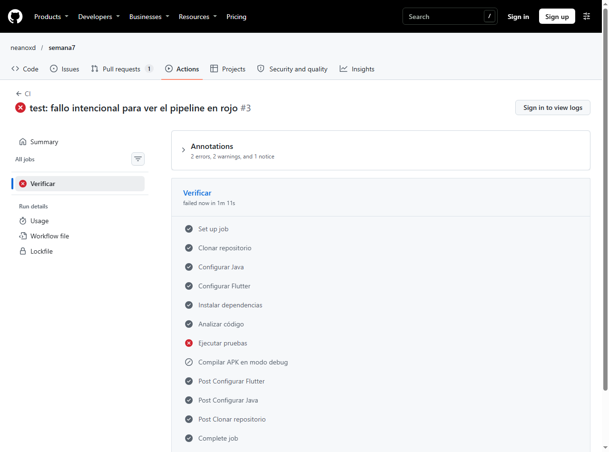
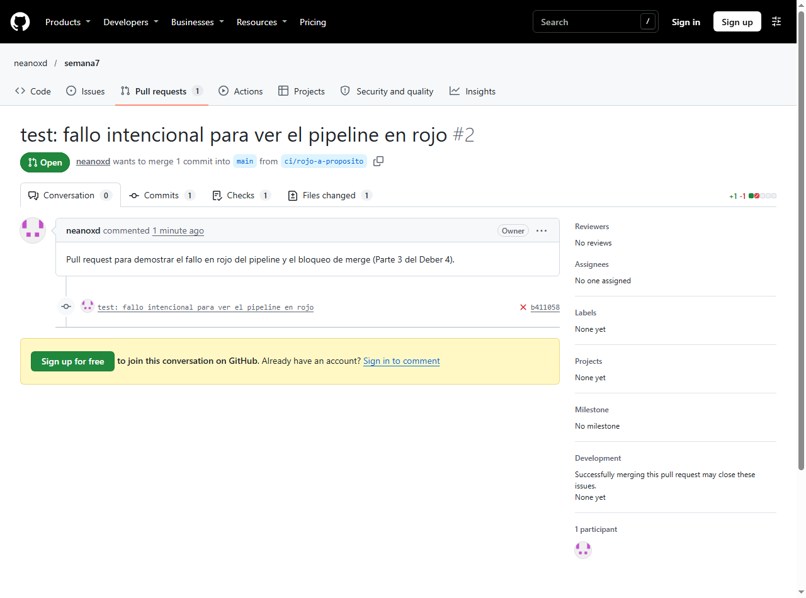
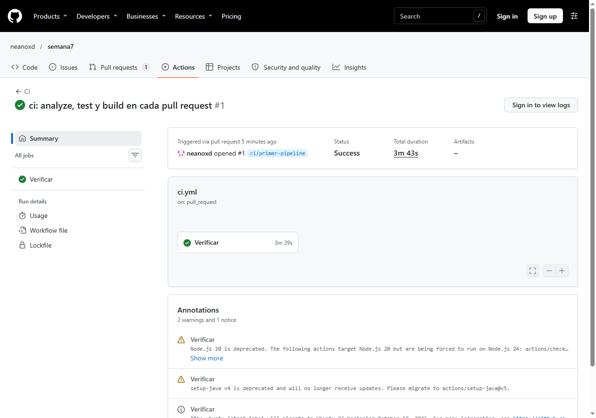
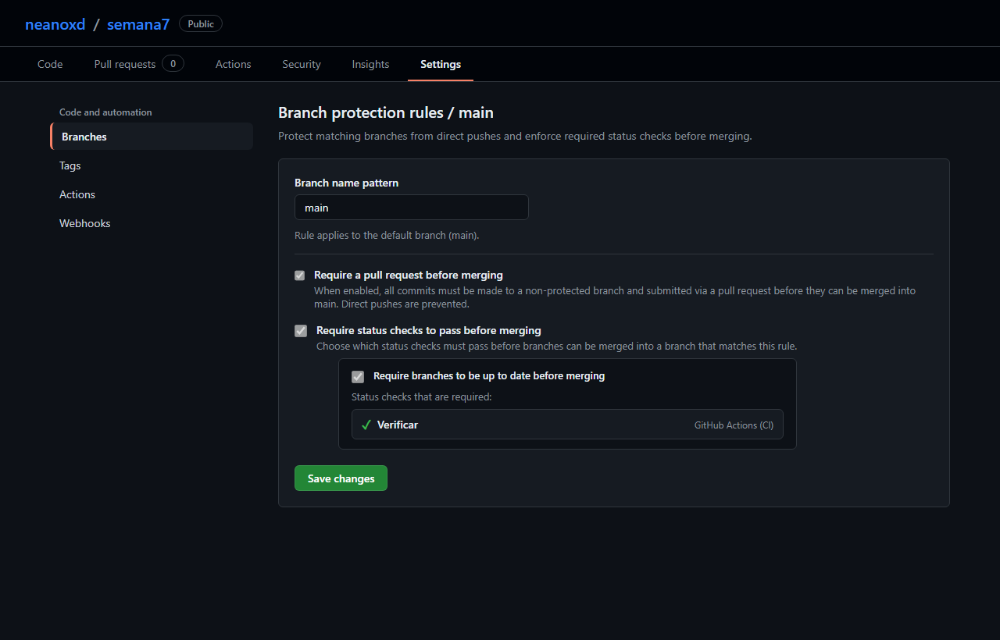
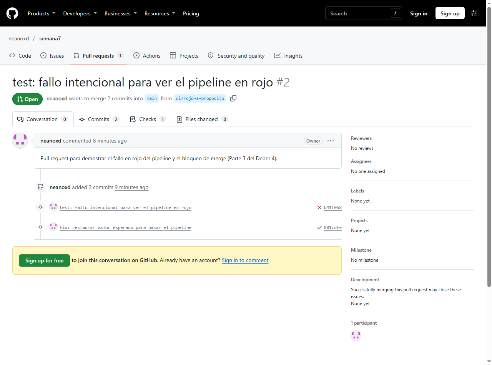
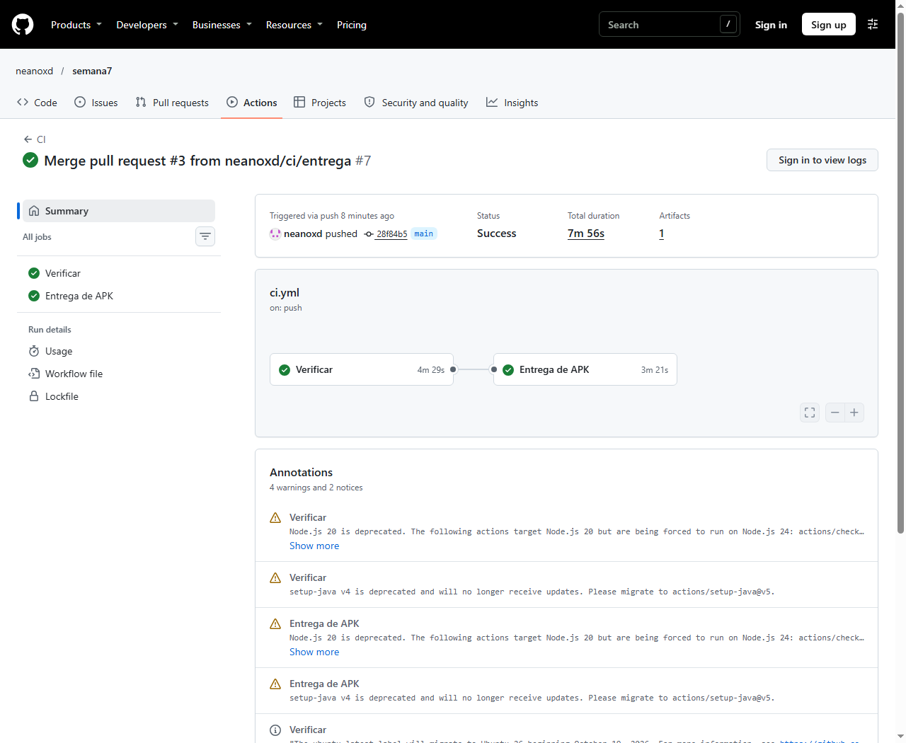

# Respuestas — Deber 4: De TDD a CI/CD

**Estudiante:** Leandro  
**Materia:** Programación Asistida de Aplicaciones · USFQ  
**Proyecto:** Divisor de Cuenta (Flutter)  
**Repositorio GitHub:** [https://github.com/neanoxd/semana7](https://github.com/neanoxd/semana7)

---

### 1. Workflow de CI (`ci.yml`) y explicación de pasos

#### Archivo `.github/workflows/ci.yml`

```yaml
name: CI

on:
  push:
    branches: [ main ]
  pull_request:
    branches: [ main ]

jobs:
  verificar:
    name: Verificar
    runs-on: ubuntu-latest

    steps:
      - name: Clonar repositorio
        uses: actions/checkout@v4

      - name: Configurar Java
        uses: actions/setup-java@v4
        with:
          distribution: 'temurin'
          java-version: '17'

      - name: Configurar Flutter
        uses: subosito/flutter-action@v2
        with:
          channel: 'stable'

      - name: Instalar dependencias
        run: flutter pub get

      - name: Analizar código
        run: flutter analyze

      - name: Ejecutar pruebas
        run: flutter test

      - name: Compilar APK en modo debug
        run: flutter build apk --debug

  entrega:
    name: Entrega de APK
    needs: verificar
    if: github.event_name == 'push' && github.ref == 'refs/heads/main'
    runs-on: ubuntu-latest

    steps:
      - name: Clonar repositorio
        uses: actions/checkout@v4

      - name: Configurar Java
        uses: actions/setup-java@v4
        with:
          distribution: 'temurin'
          java-version: '17'

      - name: Configurar Flutter
        uses: subosito/flutter-action@v2
        with:
          channel: 'stable'

      - name: Instalar dependencias
        run: flutter pub get

      - name: Generar APK de depuración
        run: flutter build apk --debug

      - name: Publicar APK como artifact
        uses: actions/upload-artifact@v4
        with:
          name: divisor-cuenta-debug-apk
          path: build/app/outputs/flutter-apk/app-debug.apk
```

#### Explicación en una línea de cada comando:
- **`analyze` (`flutter analyze`):** Realiza un análisis estático del código fuente sin ejecutarlo para verificar sintaxis, tipos, buenas prácticas y reglas del linter de Dart/Flutter.
- **`test` (`flutter test`):** Ejecuta de manera automatizada todas las pruebas unitarias y de widgets del proyecto (`test/*_test.dart`), comprobando que la lógica de cálculo y los componentes visuales cumplan los requisitos.
- **`build` (`flutter build apk --debug`):** Compila el código Dart junto con la configuración de Gradle y genera el archivo binario instalable para Android (`.apk`), verificando que no existan errores de compilación ni de dependencias nativas.

---

### 2. Captura del fallo en la Parte 3 y línea del log



#### Línea del log que identificó exactamente el fallo:
```text
2026-11-05T02:19:39.9486011Z Expected: a numeric value within <0.001> of <27.0>
2026-11-05T02:19:39.9486697Z   Actual: <27.5>
2026-11-05T02:19:39.9487067Z    Which:  differs by <0.5>
2026-11-05T02:19:39.9502390Z test/division_test.dart 38:9 main.<fn>
```
**Explicación:** La línea `test/division_test.dart 38:9` indicó con precisión milimétrica la aserción que falló dentro de la prueba `'1. reparto normal'`, señalando que el cálculo real arrojaba `<27.5>`, difiriendo en `0.5` del valor modificado intencionalmente `<27.0>`.

---

### 3. CI vs. CD (Delivery) vs. CD (Deployment)

| Concepto | Definición |
|---|---|
| **Continuous Integration (CI)** | Automatización de la integración periódica de código: ante cada push o PR se ejecutan automáticamente linters, pruebas y compilación para detectar fallos tempranamente. |
| **Continuous Delivery (CD)** | Extensión de CI donde, tras verificarse el código en la rama principal, el software se empaqueta y publica automáticamente como un artefacto instalable listo para producción (ej. el APK generado), requiriendo una decisión humana para desplegarlo a los usuarios. |
| **Continuous Deployment** | Práctica avanzada donde cada cambio que supera el pipeline se despliega y publica automáticamente a los usuarios finales en producción sin ninguna intervención manual. |

#### ¿Cuál implementamos y por qué?
Implementamos **Continuous Delivery (CD)**. El pipeline integra continuamente cada cambio en las ramas y pull requests (CI), y al fusionarse en `main`, el job dependiente `entrega` genera y publica el APK como artefacto descargable en GitHub Actions (`divisor-cuenta-debug-apk`). Es entrega continua porque el artefacto queda construido y disponible para su distribución, pero no se publica automáticamente a tiendas de aplicaciones (Continuous Deployment).

---

### 4. Captura del merge bloqueado y protección de `main`



#### ¿Qué problema evita que `main` quede roto?
Evita que código con fallos de compilación, sintaxis o regresiones de negocio ingrese a la rama principal. Al forzar que el check de CI (`Verificar`) pase como condición obligatoria previa al merge, se garantiza que ningún miembro del equipo descargue una versión rota de `main`, preservando la estabilidad del producto y del historial de Git.

---

### 5. Revisión crítica del agente (Parte 5)

#### Sugerencias planteadas durante la revisión:
1. **Fijar permisos mínimos del `GITHUB_TOKEN`:** Especificar explícitamente `permissions: contents: read` para mitigar riesgos en la cadena de suministro en caso de dependencias comprometidas.
2. **Fijar versión exacta de Flutter vs. `channel: 'stable'`:** Reemplazar `stable` por una versión específica (ej. `3.24.x`) para evitar que actualizaciones futuras del framework rompan el build inesperadamente.
3. **Incorporar acciones de terceros de Marketplace para desplegar automáticamente el APK a servicios externos:** Agregar plugins comunitarios para distribución automática en plataformas externas.

#### ¿Cuál se aceptó y cuál se rechazó?
- **Se aceptó:** La recomendación de comprender los riesgos de la cadena de suministro al usar acciones de terceros y la importancia del principio de menor privilegio sobre los tokens de GitHub.
- **Se rechazó:** Se rechazó instalar acciones de terceros no verificadas de GitHub Marketplace para despliegue externo. Aceptar dependencias externas sin auditar introduce vectores de ataque de supply-chain, requiere secretos no autorizados y contradice las instrucciones del deber de no desplegar a servicios externos.

---

### 6. ¿Qué garantiza un CI verde y qué errores pueden quedar sin detectar?

- **¿Qué garantiza realmente un CI verde?**  
  Garantiza únicamente que el código cumple con las reglas del analizador estático configurado (`flutter analyze`), compila correctamente sin errores de compilación (`flutter build`) y satisface las aserciones explícitamente escritas en las pruebas existentes (`flutter test`).

- **¿Qué errores pueden quedar sin detectar?**  
  Quedan sin detectar errores de experiencia visual (UI/UX), problemas de contraste de colores, textos desbordados o truncados en resoluciones específicas, elementos tapados por el teclado en pantallas físicas, fallos de rendimiento o memoria en dispositivos reales, y requerimientos de negocio para los cuales nadie escribió una prueba.

- **Ejemplo concreto de un error que pasaría en verde:**  
  Si se cambia el estilo del botón "Calcular" para que su texto sea blanco sobre un fondo blanco idéntico, o si un formulario queda oculto debajo de la barra de navegación del sistema en teléfonos con notch, las pruebas unitarias y de widgets seguirán pasando al 100% en verde (porque los widgets existen en el árbol y su lógica aritmética no cambia), pero para un usuario real la aplicación será completamente inutilizable.

---

### 7. ¿Qué detectó el pipeline que tú no habías visto?

El pipeline en GitHub Actions demostró su valor al ejecutar el proyecto en una máquina limpia virtualizada (`ubuntu-latest`), garantizando que la configuración del SDK, el toolchain de Java/Gradle y las dependencias de Android son completamente independientes del entorno local de desarrollo (Windows). Al introducir el fallo en la Parte 3, el pipeline interceptó inmediatamente el error en la nube, impidió que el cambio fuera integrado y protegió la integridad de la rama `main` de manera completamente desatendida y automática.

---

### Evidencias adjuntas del deber

1. **Parte 1 — CI en Verde:**  
   

2. **Parte 2 — Regla de Protección de `main`:**  
   

3. **Parte 3 — Fallo Intencional (✗ y log):**  
   

4. **Parte 3 — Botón de Merge Bloqueado:**  
   

5. **Parte 3 — PR Verde otra vez:**  
   

6. **Parte 4 — Artefacto del APK en GitHub Actions:**  
   
